<p align="center">
  
</p>

<p align="center">
  <strong>The missing French cleat subsystem.</strong><br>
  Generate a holder that fits your tool exactly, print it and slide it onto your wall.
</p>

<p align="center">
  <a href="https://makerworld.com/de/models/1448891-frenchfinity-2-0-customizable#profileId-1558890"></a>
</p>

<p align="center">
  <a href="https://github.com/Bastelsaal/frenchfinity-openscad/actions/workflows/build.yml"></a>
  <a href="https://creativecommons.org/licenses/by-nc-sa/4.0/"></a>
  <a href="https://frenchfinity.xyz"></a>
  <a href="https://www.youtube.com/watch?v=pbA6Cf03Jpg"></a>
</p>

<p align="center">
  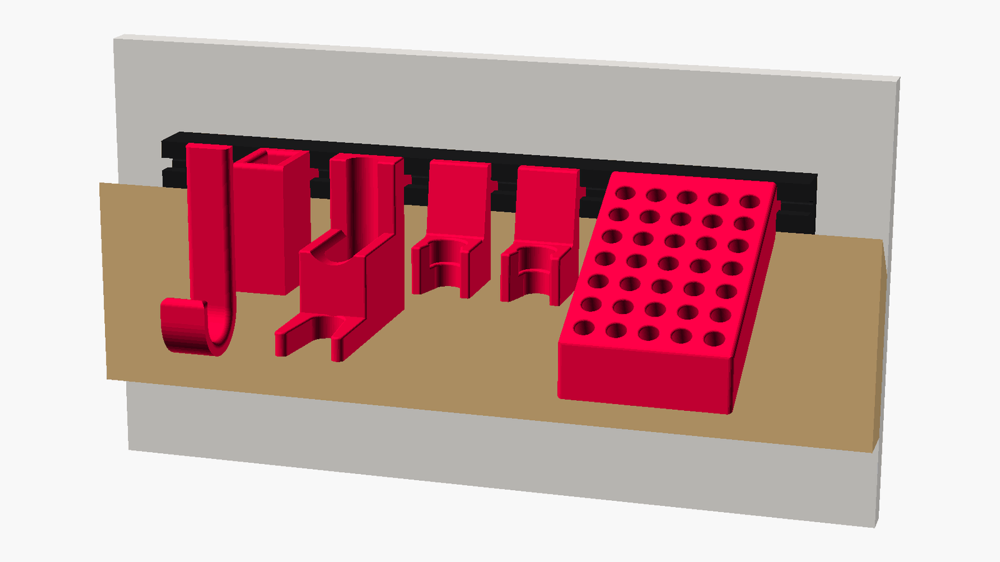
</p>

French cleat walls are great, until you build the tenth custom holder by hand. **Frenchfinity**
fixes that: printed wall anchors hook onto the wooden cleats, and every holder slides into them
from the side. **Frenchfinity 2.0** is the generator for the whole system: 45 parametric parts in
one OpenSCAD file, ready for the MakerWorld customizer.

<p align="center">
  <a href="#get-started">Get started</a> ·
  <a href="#parts">Parts</a> ·
  <a href="#printing">Printing</a> ·
  <a href="#fits-frenchfinity-10">Compatibility</a> ·
  <a href="#development">Development</a>
</p>

## Why Frenchfinity

- **Made for your tool.** Enter the size of your screwdriver, file or pliers and get a holder that
  fits it exactly. No more holders that almost fit.
- **45 parts, one generator.** Wall anchors, plates for walls without cleats, 34 holders and boxes
  and the helpers to make wooden parts. All of them use the same slot profile.
- **Slide in, lock, done.** Holders slide into the anchor from the side. A piece of leftover 1.75 mm
  filament locks them in place.
- **Fits Frenchfinity 1.0.** The slot profile matches the original Fusion 360 parts exactly, so old
  and new parts mix, and so do wooden anchors milled with an M5 T-slot cutter.
- **Labeled for the next print.** Every part carries the parameters it was made with, and the
  generator proposes a matching file name.
- **Tested on every change.** GitHub renders all 45 parts on every push, from the sources and from
  the file that goes to MakerWorld.

## How it works

1. **Wall:** screw wooden French cleats to the wall. No cleats? Use a screw plate, the IKEA Skadis
   plate or the welding table plate instead.
2. **Anchor:** hang printed wall anchors onto the cleats. Their front carries the T-slot. Screws
   through the slot fix an anchor for good.
3. **Holder:** generate a holder for your tool, print it and slide its T-tongue into the slot from
   the side.
4. **Lock:** press a piece of 1.75 mm filament into the small channel between tongue and slot. The
   holder sits without any play.

All parts are generated in the orientation they hang on the wall: `x` along the slot, `y` from the
wall into the room, `z` up.

## Get started

**On MakerWorld (easiest):** open the
[generator on MakerWorld](https://makerworld.com/de/models/1448891-frenchfinity-2-0-customizable#profileId-1558890),
pick a part in the section "Part", enter the size of your tool in the section of that part and
generate the model. That's it, no software needed.

**In OpenSCAD:**

```
git clone --recursive https://github.com/Bastelsaal/frenchfinity-openscad.git
```

Open `src/frenchfinity.scad` in [OpenSCAD](https://openscad.org) and show the customizer
(Window > Customizer). Pick the part with the parameter `feature`, adjust its section, render (F6)
and export the STL (F7). A recent development snapshot of OpenSCAD renders every part within a few
seconds, OpenSCAD 2021.01 works as well but is much slower.

## Parts

<p align="center">
  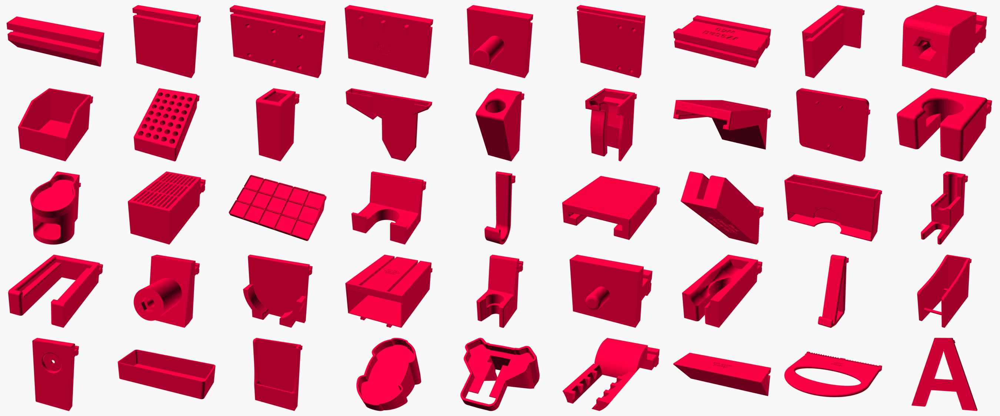
</p>

Every part below is shown with its default parameters. The id in `code` is the value of the
parameter `feature`. Parts marked <sup>new</sup> did not exist in Frenchfinity 1.0.

### Wall anchors, plates and adapters

<table>
  <tr>
    <td align="center" valign="top" width="33%">
      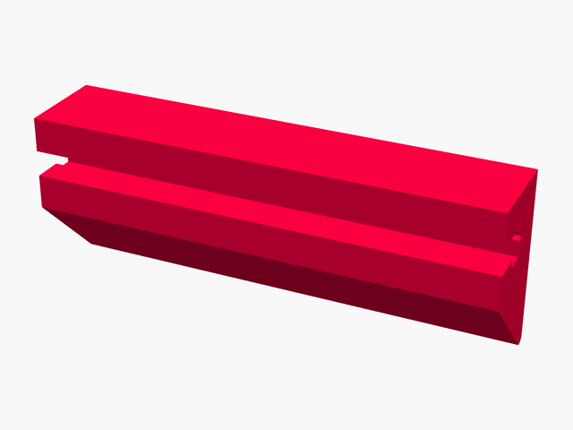<br>
      <strong>Wall anchor</strong><br>
      <code>wall_anchor</code><br>
      <sub>3D printed French cleat with the slot, hooks onto the wooden cleats of your wall, optionally with sockets for the printable labels by Pred</sub>
    </td>
    <td align="center" valign="top" width="33%">
      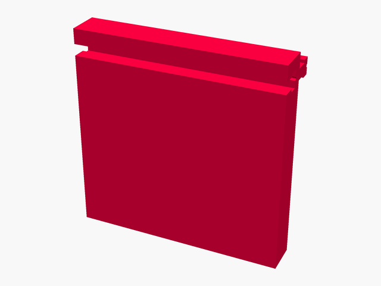<br>
      <strong>French plate</strong><br>
      <code>french_plate</code><br>
      <sub>Adds height below short holders, optionally with several slots and tongues</sub>
    </td>
    <td align="center" valign="top" width="33%">
      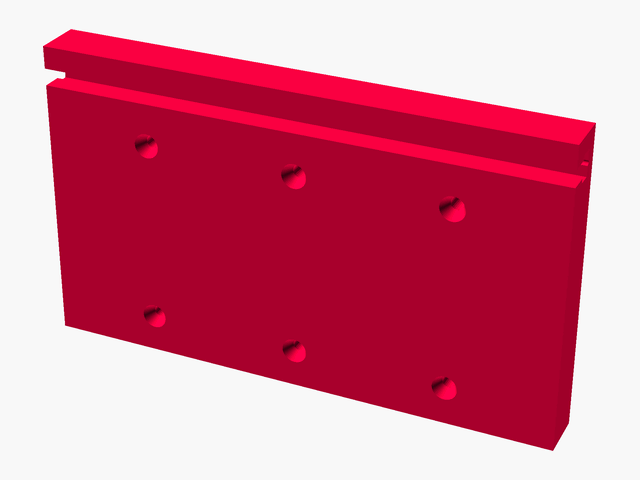<br>
      <strong>Screw plate</strong><br>
      <code>screw_plate</code><br>
      <sub>Slot and countersunk screw holes, for walls without cleats</sub>
    </td>
  </tr>
  <tr>
    <td align="center" valign="top" width="33%">
      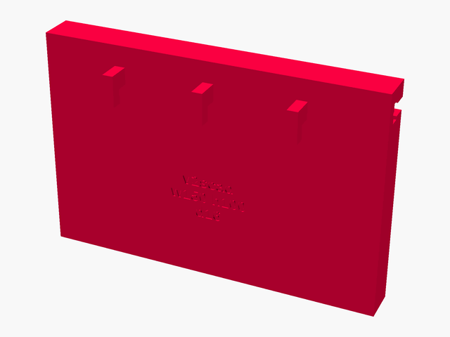<br>
      <strong>IKEA Skadis plate</strong><br>
      <code>ikea_skadis_plate</code><br>
      <sub>Slot and hooks for the IKEA Skadis pegboard</sub>
    </td>
    <td align="center" valign="top" width="33%">
      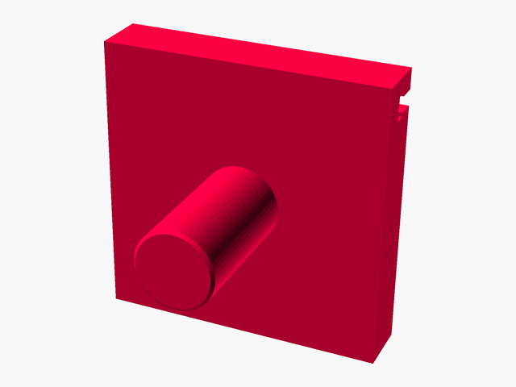<br>
      <strong>Welding table plate</strong> <sup>new</sup><br>
      <code>welding_table_plate</code><br>
      <sub>Slot and pins for the D16 or D28 holes of a welding table</sub>
    </td>
    <td align="center" valign="top" width="33%">
      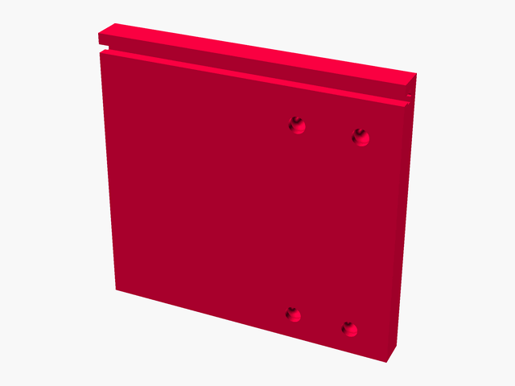<br>
      <strong>Nussbaum SL smart lift plate</strong><br>
      <code>nussbaum_sl_smart_lift_plate</code><br>
      <sub>Base plate for the column of a Nussbaum SL smart lift</sub>
    </td>
  </tr>
  <tr>
    <td align="center" valign="top" width="33%">
      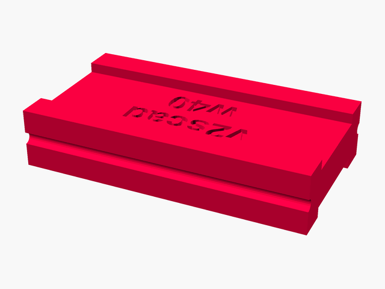<br>
      <strong>Custom base adapter</strong><br>
      <code>custom_base_adapter</code><br>
      <sub>Two tongues back to back, connects parts that both have slots</sub>
    </td>
    <td align="center" valign="top" width="33%">
      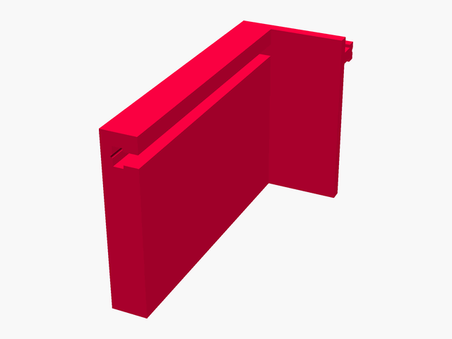<br>
      <strong>Angle adapter</strong><br>
      <code>angle_adapter</code><br>
      <sub>Turns holders by an angle, e.g. by 90° so they face sideways</sub>
    </td>
  </tr>
</table>

### Tool holders

<table>
  <tr>
    <td align="center" valign="top" width="33%">
      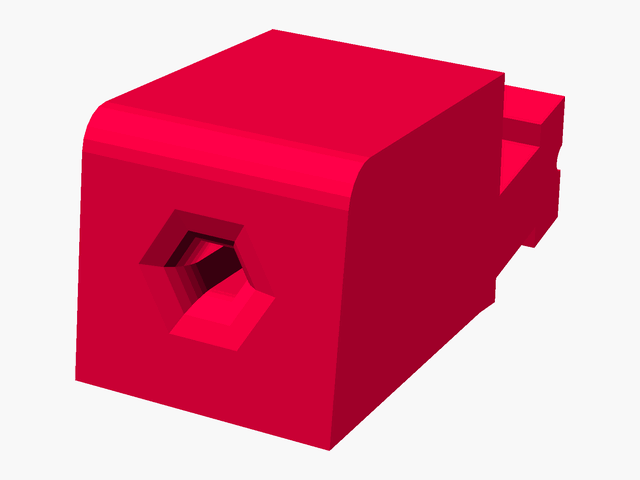<br>
      <strong>Allen key holder</strong><br>
      <code>allen_key_holder</code><br>
      <sub>One Allen key</sub>
    </td>
    <td align="center" valign="top" width="33%">
      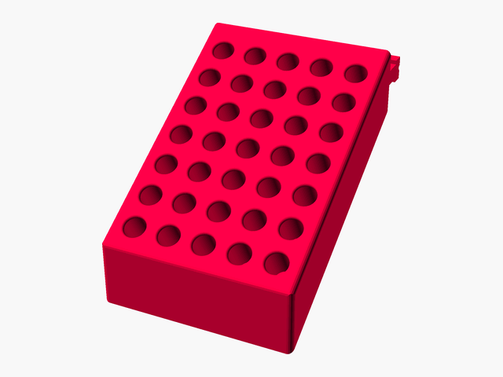<br>
      <strong>Bit holder</strong><br>
      <code>bit_holder</code><br>
      <sub>Grid of tilted holes for bits, drills and other round shanks</sub>
    </td>
    <td align="center" valign="top" width="33%">
      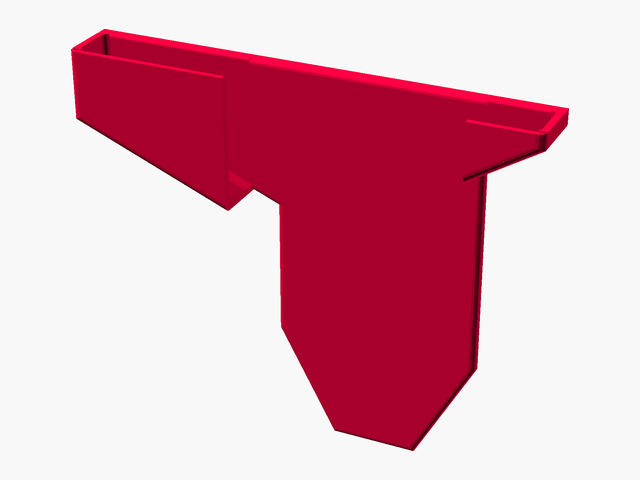<br>
      <strong>Caliper holder</strong><br>
      <code>caliper_holder</code><br>
      <sub>A caliper</sub>
    </td>
  </tr>
  <tr>
    <td align="center" valign="top" width="33%">
      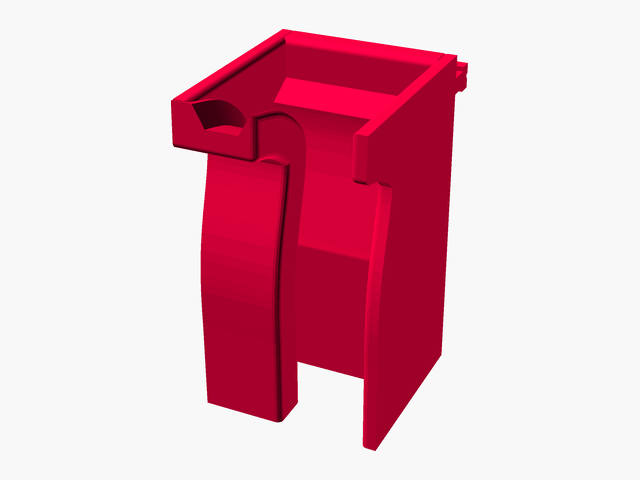<br>
      <strong>Crowbar holder</strong><br>
      <code>crowbar_holder</code><br>
      <sub>Crowbars and other long tools</sub>
    </td>
    <td align="center" valign="top" width="33%">
      <br>
      <strong>File holder</strong><br>
      <code>file_holder</code><br>
      <sub>A file, held by its handle</sub>
    </td>
    <td align="center" valign="top" width="33%">
      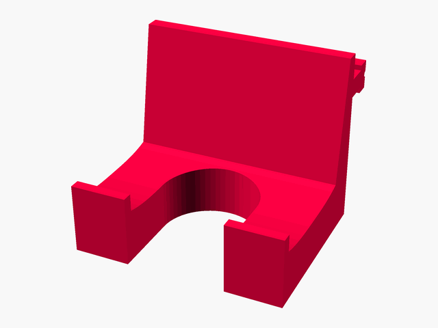<br>
      <strong>Hammer holder</strong><br>
      <code>hammer_holder</code><br>
      <sub>A hammer, the handle hangs through a U-shaped gap</sub>
    </td>
  </tr>
  <tr>
    <td align="center" valign="top" width="33%">
      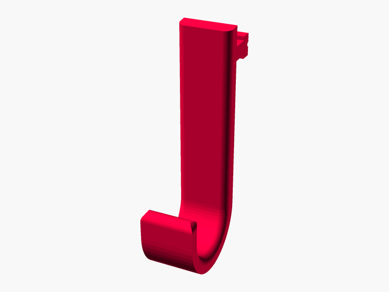<br>
      <strong>Hook</strong><br>
      <code>hook</code><br>
      <sub>Cables, wires and small tools</sub>
    </td>
    <td align="center" valign="top" width="33%">
      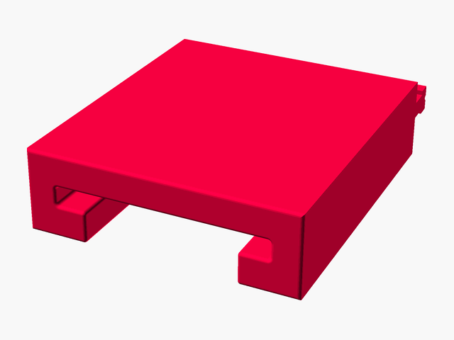<br>
      <strong>Lifting clamp holder</strong><br>
      <code>lifting_clamp_holder</code><br>
      <sub>Lifting clamps</sub>
    </td>
    <td align="center" valign="top" width="33%">
      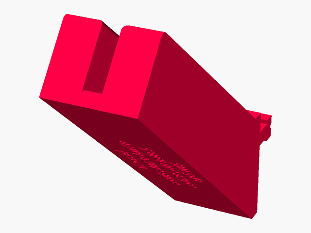<br>
      <strong>Locksmith corner holder</strong><br>
      <code>locksmith_corner_holder</code><br>
      <sub>A try square</sub>
    </td>
  </tr>
  <tr>
    <td align="center" valign="top" width="33%">
      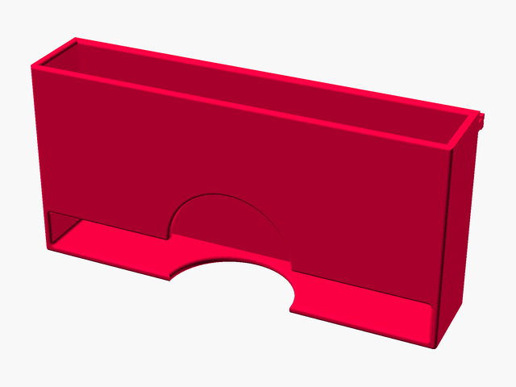<br>
      <strong>Meter stick holder</strong><br>
      <code>meter_stick_holder</code><br>
      <sub>Folding rules</sub>
    </td>
    <td align="center" valign="top" width="33%">
      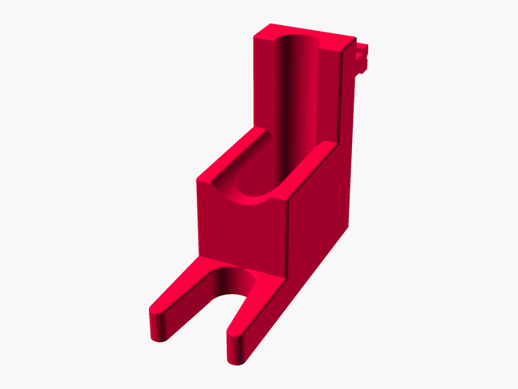<br>
      <strong>Pliers holder</strong><br>
      <code>pliers_holder</code><br>
      <sub>One pair of pliers, held by one of its handles</sub>
    </td>
    <td align="center" valign="top" width="33%">
      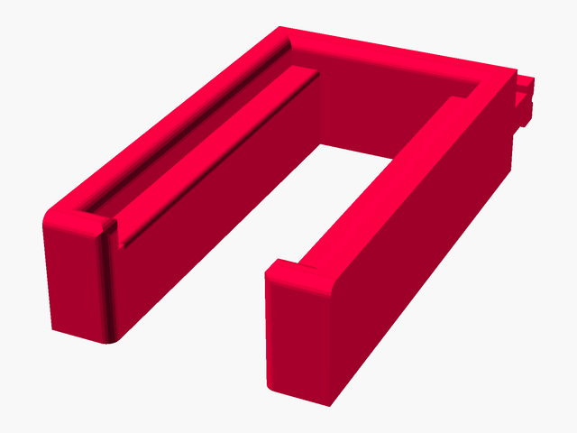<br>
      <strong>Rectangular tool holder</strong><br>
      <code>rectangular_tool_holder</code><br>
      <sub>Tools with a flat rectangular head and a handle below it</sub>
    </td>
  </tr>
  <tr>
    <td align="center" valign="top" width="33%">
      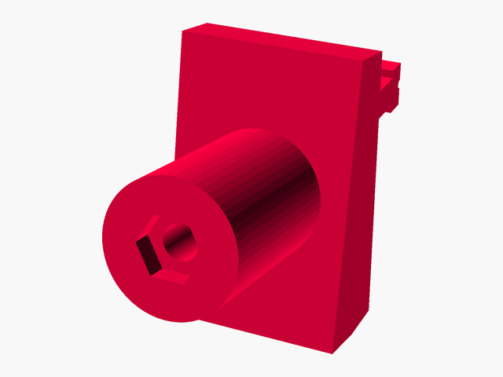<br>
      <strong>Ring wrench holder</strong><br>
      <code>ring_wrench_holder</code><br>
      <sub>Ring wrenches on a stick</sub>
    </td>
    <td align="center" valign="top" width="33%">
      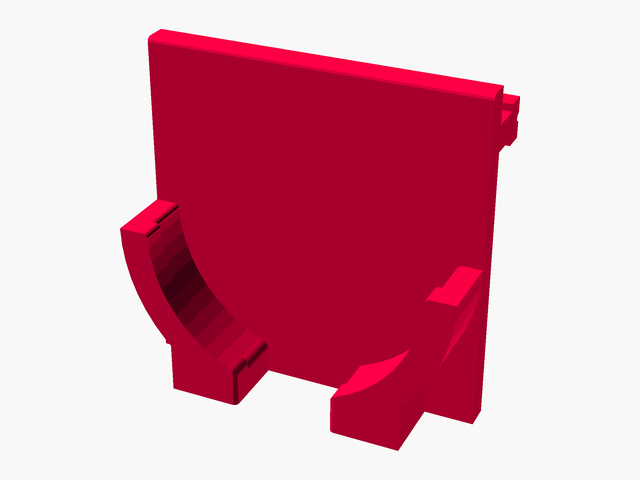<br>
      <strong>Round hanging holder</strong><br>
      <code>round_hanging_holder</code><br>
      <sub>Round tools, brushes and cables</sub>
    </td>
    <td align="center" valign="top" width="33%">
      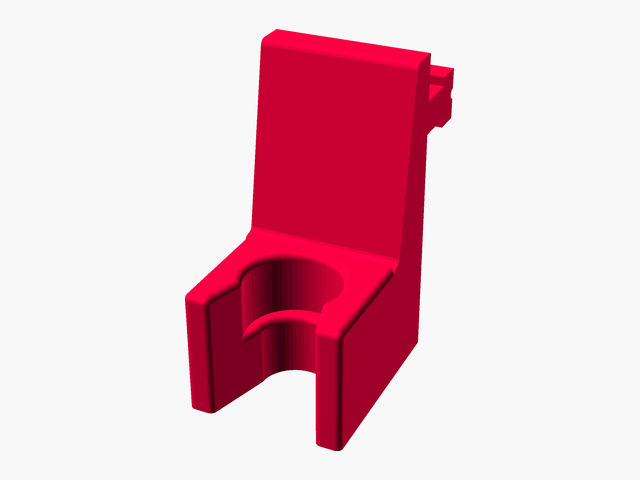<br>
      <strong>Screwdriver holder</strong><br>
      <code>screw_driver</code><br>
      <sub>One screwdriver</sub>
    </td>
  </tr>
  <tr>
    <td align="center" valign="top" width="33%">
      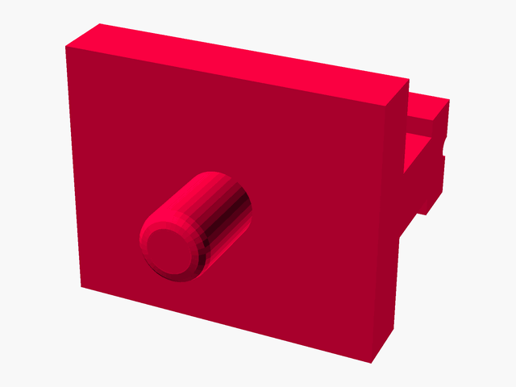<br>
      <strong>Small hole holder</strong><br>
      <code>small_hole_holder</code><br>
      <sub>A pin for tools with a small hanging hole</sub>
    </td>
    <td align="center" valign="top" width="33%">
      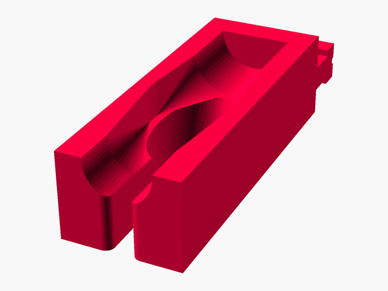<br>
      <strong>T-handle holder</strong><br>
      <code>t_handle_holder</code><br>
      <sub>Tools with a T-handle</sub>
    </td>
    <td align="center" valign="top" width="33%">
      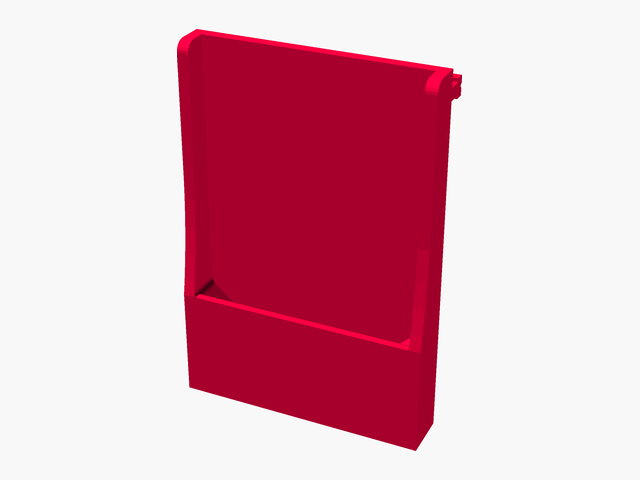<br>
      <strong>Triangle top holder</strong><br>
      <code>triangle_top_holder</code><br>
      <sub>Triangular and odd shaped tools</sub>
    </td>
  </tr>
  <tr>
    <td align="center" valign="top" width="33%">
      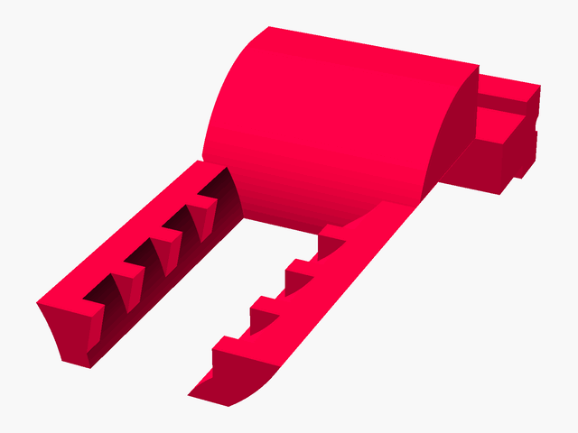<br>
      <strong>Wrench holder</strong><br>
      <code>wrench_holder</code><br>
      <sub>A set of wrenches, sorted by size</sub>
    </td>
  </tr>
</table>

### Storage

<table>
  <tr>
    <td align="center" valign="top" width="33%">
      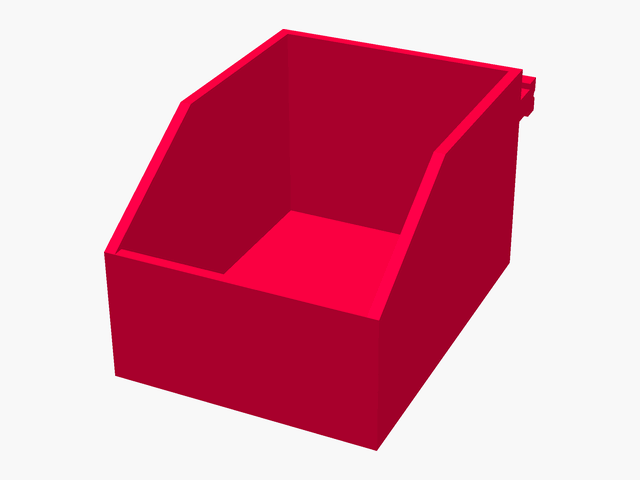<br>
      <strong>Bin</strong> <sup>new</sup><br>
      <code>bin</code><br>
      <sub>Open bin with a low front wall for small parts</sub>
    </td>
    <td align="center" valign="top" width="33%">
      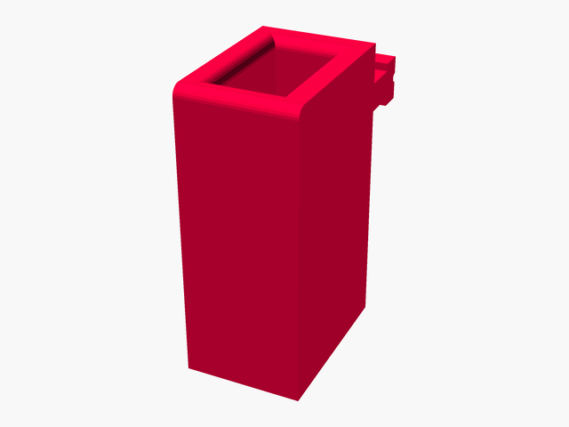<br>
      <strong>Box</strong><br>
      <code>box</code><br>
      <sub>Rectangular box for boxy tools and small parts</sub>
    </td>
    <td align="center" valign="top" width="33%">
      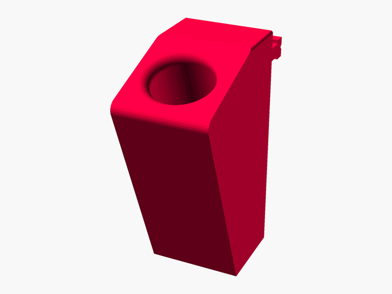<br>
      <strong>Can holder</strong><br>
      <code>can_holder</code><br>
      <sub>Spray and paint cans</sub>
    </td>
  </tr>
  <tr>
    <td align="center" valign="top" width="33%">
      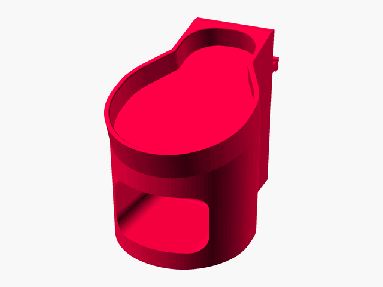<br>
      <strong>GluBot holder</strong><br>
      <code>glubot_holder</code><br>
      <sub>A GluBot glue bottle, standing upright</sub>
    </td>
    <td align="center" valign="top" width="33%">
      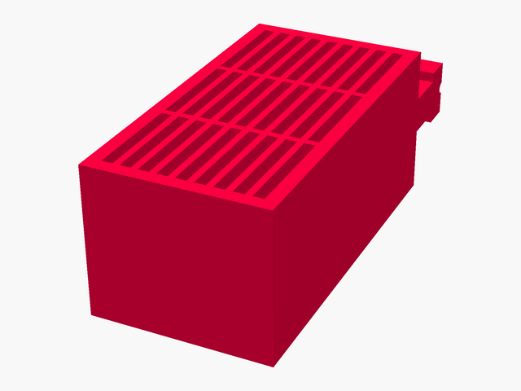<br>
      <strong>Grid holder</strong><br>
      <code>grid</code><br>
      <sub>Box with a grid of compartments</sub>
    </td>
    <td align="center" valign="top" width="33%">
      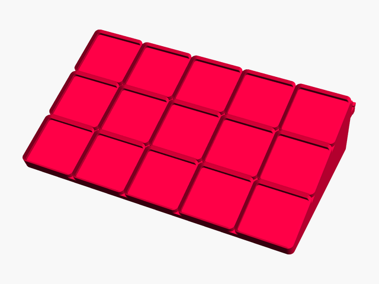<br>
      <strong>Gridfinity adapter</strong><br>
      <code>gridfinity_adapter</code><br>
      <sub>Tilted Gridfinity baseplate for standard Gridfinity bins</sub>
    </td>
  </tr>
  <tr>
    <td align="center" valign="top" width="33%">
      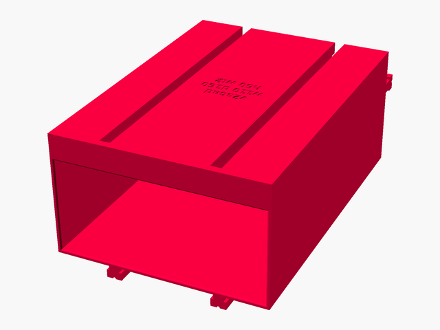<br>
      <strong>Sandpaper holder</strong><br>
      <code>sandpaper_holder</code><br>
      <sub>Keeps sandpaper sheets flat</sub>
    </td>
    <td align="center" valign="top" width="33%">
      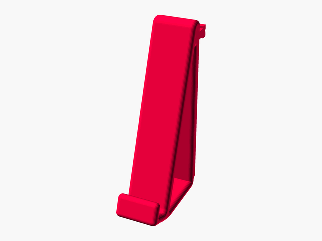<br>
      <strong>Tablet holder</strong><br>
      <code>tablet_holder</code><br>
      <sub>A tablet for manuals and tutorials</sub>
    </td>
    <td align="center" valign="top" width="33%">
      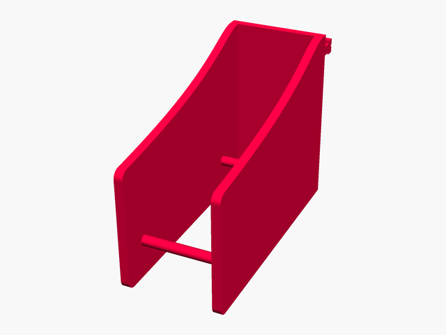<br>
      <strong>Tape holder</strong><br>
      <code>tape_holder</code><br>
      <sub>Rolls of tape</sub>
    </td>
  </tr>
  <tr>
    <td align="center" valign="top" width="33%">
      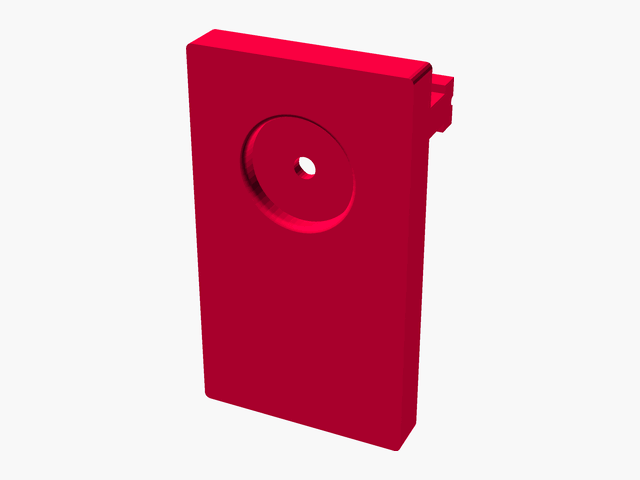<br>
      <strong>Toilet paper holder</strong><br>
      <code>toilet_paper_holder</code><br>
      <sub>A roll of paper</sub>
    </td>
    <td align="center" valign="top" width="33%">
      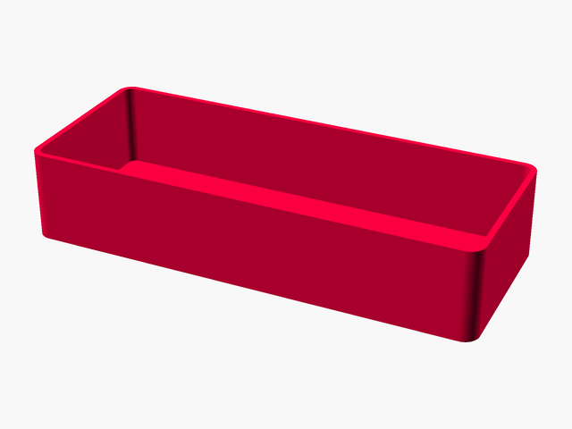<br>
      <strong>Tray</strong> <sup>new</sup><br>
      <code>tray</code><br>
      <sub>Open tray with rounded corners for small parts</sub>
    </td>
  </tr>
</table>

### Made for one product

<table>
  <tr>
    <td align="center" valign="top" width="33%">
      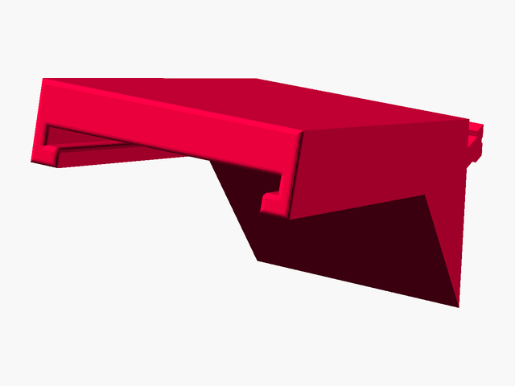<br>
      <strong>Einhell battery holder</strong><br>
      <code>einhell_battery_holder</code><br>
      <sub>An Einhell Power X-Change battery</sub>
    </td>
    <td align="center" valign="top" width="33%">
      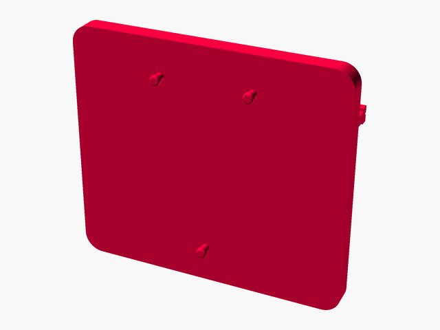<br>
      <strong>Einhell single charger holder</strong><br>
      <code>einhell_single_charger_holder</code><br>
      <sub>The Einhell Power X-Change single charger</sub>
    </td>
    <td align="center" valign="top" width="33%">
      <br>
      <strong>Wolfcraft Accumobil holder</strong><br>
      <code>wolfcraft_accumobil_drilling_aid_holder</code><br>
      <sub>The Wolfcraft Accumobil drilling aid</sub>
    </td>
  </tr>
  <tr>
    <td align="center" valign="top" width="33%">
      <br>
      <strong>Wolfcraft ES 22 holder</strong><br>
      <code>wolfcraft_corner_clamp_es22_holder</code><br>
      <sub>The Wolfcraft ES 22 corner clamp</sub>
    </td>
  </tr>
</table>

### Workshop helpers

<table>
  <tr>
    <td align="center" valign="top" width="33%">
      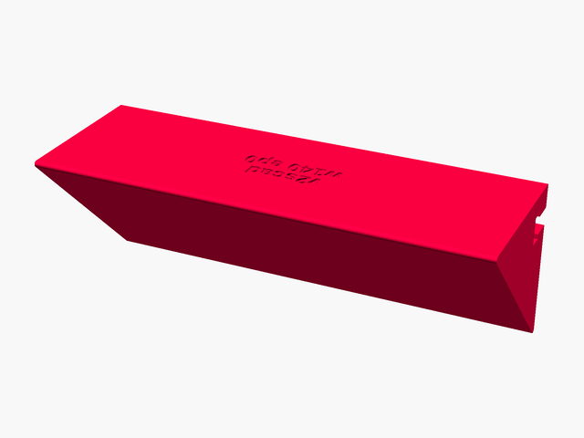<br>
      <strong>Guide</strong><br>
      <code>guide</code><br>
      <sub>Sets up router and table saw to make wooden Frenchfinity parts</sub>
    </td>
    <td align="center" valign="top" width="33%">
      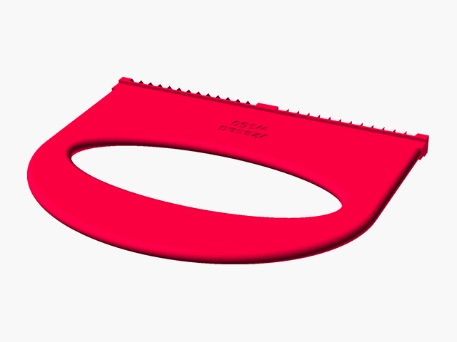<br>
      <strong>Tongue cleaner</strong><br>
      <code>tongue_cleaner</code><br>
      <sub>Cleans slots milled with the router bit</sub>
    </td>
    <td align="center" valign="top" width="33%">
      <br>
      <strong>Letter</strong><br>
      <code>letter</code><br>
      <sub>Letters and short words that hang on the wall</sub>
    </td>
  </tr>
</table>

## Printing

What worked for us, on a Bambu Lab X1 Carbon:

- **Layer height:** the preset 0.28 mm Extra Draft is fine for almost every part.
- **Supports:** most parts need a little support for the slot or the tongue. Depending on the part,
  printing it rotated by 90° avoids supports completely. Use regular supports instead of tree
  supports, the thin trees tend to fail on high holders (one or two raft layers help, too), and
  enable "support on build plate only", otherwise the engraved labels and the screw holes get useless
  support. With PLA, the support material came off more easily with "Support for PLA" than with
  "Support for PLA/PETG".
- **Infill:** 10 % is enough for most parts. For more strength in the tongue, cut the model in two
  parts in Bambu Studio (enable "cut to parts") and raise the infill of the part with the tongue to
  90 %.
- **Fit:** tongues are 0.12 mm smaller than the slot on every side (`print_tolerance`). Increase it
  if the holders are too tight on your printer.

## What you need

- **Printed parts only:** no tools.
- **Screws:** 2.0 x 20 mm screws fix a printed wall anchor to the wooden cleat.
- **Wooden wall anchors:** an M5 T-slot cutter mills the slot into your own wooden cleats. The
  `guide` sets up the router and the table saw, the `tongue_cleaner` cleans the milled slots.
- **Sanding:** a sanding sponge smooths a tongue that is too tight.
- **Filament leftovers:** a short piece of 1.75 mm filament locks every holder. Frenchfinity is the
  perfect use for the last meters on a spool.

## Fits Frenchfinity 1.0

The default slot profile `frenchfinity` reproduces the Frenchfinity 1.0 parts (Fusion 360) exactly,
so 1.0 and 2.0 parts can be mixed, and wooden parts milled with the M5 T-slot router bit fit as well:

| Dimension                                     | Slot      | Tongue      |
|-----------------------------------------------|-----------|-------------|
| Opening (neck) height x depth                 | 5.6 x 6.5 | 5.36 x 6.62 |
| Wide part (head) height x depth               | 8.5 x 4.5 | 8.26 x 4.26 |
| Distance from the top edge to the center line | 10.194    | 10.194      |
| Filament channel                              | 1.7       | 1.7         |

Tongues are smaller by `print_tolerance` (0.12 mm) on every side. Further profiles:

- `openscad_v1_legacy`: parts generated with version 1 of this generator (labeled `v1scad`) used a
  slot with the neck dimensions swapped. Use this profile to print parts that fit those.
- `custom`: enter all slot dimensions yourself.

Every part was checked against the Frenchfinity 1.0 STL files: generated with the same parameters,
the parts overlap the 1.0 parts by 95 to 99.9 % of their volume (the 1.0 labels are engraved deeper).

<details>
<summary>Deliberate differences to Frenchfinity 1.0</summary>

- Labels are engraved 0.6 mm deep (`text_depth`), lengths are always given in mm.
- Box: when the box is lower than the tongue, its floor reaches down to the tongue, so it prints flat.
- Grid holder: all cells have the same size, `grid_legacy_layout` restores the 1.0 layout.
- Bit holder: the holes never break through the back face (some 1.0 sizes drilled into it).
- Gridfinity adapter: `gridfinity_adapter_angle` is the real tilt, the 1.0 parts named `a10` are tilted by 20°.
- Guide: the slot has the size of the slot milled by the router bit (1.0: the size of a tongue).
- Letter: any text, the default font is Liberation Sans Bold (1.0: Arial Bold, set `letter_font`
  to `Arial:style=Bold` where it is installed).
- Einhell single charger holder and GluBot holder hang level (1.0 was slightly rotated), the tongue
  of the Wolfcraft holders is centered.

</details>

## Labels and file names

Like Frenchfinity 1.0, every part has the parameters it was generated with engraved, as short
abbreviations followed by their value (`w100` = width 100 mm), plus the version (`v2scad`). Disable
this with `render_text = false`.

OpenSCAD cannot set the name of an exported file, so the generator prints a file name proposal
containing the same abbreviations to the console. Look for `ECHO: "filename proposal:"`:

```
ECHO: "filename proposal:", "frenchfinity-wall-anchor-v2scad-w100-h40.4-d20-a45.stl"
```

## Development

The generator needs [BOSL2](https://github.com/BelfrySCAD/BOSL2), included as a git submodule
(`git submodule update --init` in an existing clone).

| Path                          | Content                                                                    |
|-------------------------------|----------------------------------------------------------------------------|
| `src/frenchfinity.scad`       | Main file: all customizer parameters and the part selection                |
| `src/core/`                   | Slot profile, tongues and slots, labels and file names, helpers            |
| `src/features/`               | One file per part                                                          |
| `build/build.sh`              | Merges everything into `dist/<timestamp>_frenchfinity.scad` for MakerWorld |
| `build/validate.sh`           | Renders every part with its default parameters and reports problems        |
| `build/render_images.sh`      | Renders the images of this README into `docs/images/`                      |
| `.github/workflows/build.yml` | Builds and validates the MakerWorld file on GitHub                         |

`build/validate.sh` takes an optional file (e.g. the merged file from `dist/`) and `--png` to render
preview images into `dist/validation/`. `build/render_images.sh` needs ImageMagick and renders every
part, or only the parts whose ids you pass.

### Automatic builds

Every push and pull request runs `build/build.sh` and `build/validate.sh` on GitHub (with the
current OpenSCAD development snapshot), for the sources and for the merged file. Every run offers the
merged file for download (Actions tab, open the run, section "Artifacts"). A pushed tag starting
with `v` publishes the file as a GitHub release:

```
git tag v2.0.0
git push origin v2.0.0
```

### Adding a part

- Create `src/features/<id>.scad` with a `module feature_<id>()` and add its parameters (section
  `/* [Name] */`, every name starting with `<id>_`), the include and the dispatcher entry to
  `src/frenchfinity.scad`.
- Coordinate system: `x` runs along the slot, `y = 0` is the mounting plane (back face of a holder,
  front face of an anchor or plate), holders extend to `+y`, anchors and plates to `-y`, `z` points
  up and the lowest point of a part is at `z = 0`.
- Use `ff_tongue(width, top)` for the tongue of a holder and subtract `ff_slot(width, top)` from
  anchors and plates, so the part follows the selected slot profile.
- Engrave the parameters with `ff_engrave_params()` and print the file name proposal with
  `ff_echo_file_name()`.
- Use `ff_offset_sweep()` instead of BOSL2's `offset_sweep()`: it builds the same shape from
  triangles, which OpenSCAD 2021.01 needs to render it reliably.
- Prefix every module, function and variable of a part with its id, all files share one namespace.
- Render its image with `build/render_images.sh <id>` and add it to the parts gallery above.

## Contributing

Found a bug or missing a holder? Open an
[issue](https://github.com/Bastelsaal/frenchfinity-openscad/issues). Pull requests are welcome, too.
Thanks to JGoodwillieV for the bin, the tray and the French plate with several slots
([#7](https://github.com/Bastelsaal/frenchfinity-openscad/pull/7)).

## License

Frenchfinity is licensed under the
[Creative Commons Attribution-NonCommercial-ShareAlike 4.0 International License](https://creativecommons.org/licenses/by-nc-sa/4.0/):
share and adapt it, give appropriate credit, do not use it for commercial purposes and share your
changes under the same license. You may use it in your workshop even if your workshop produces
commercial products.
